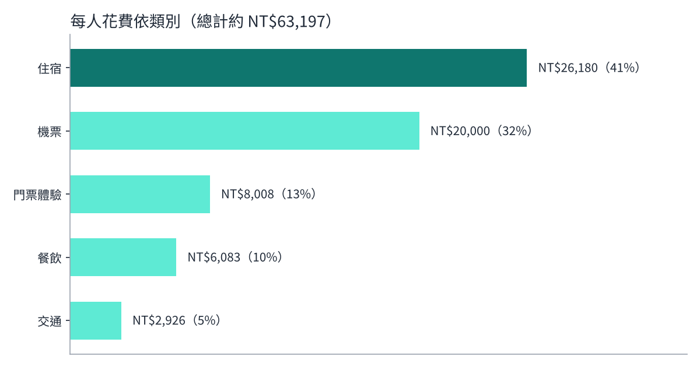
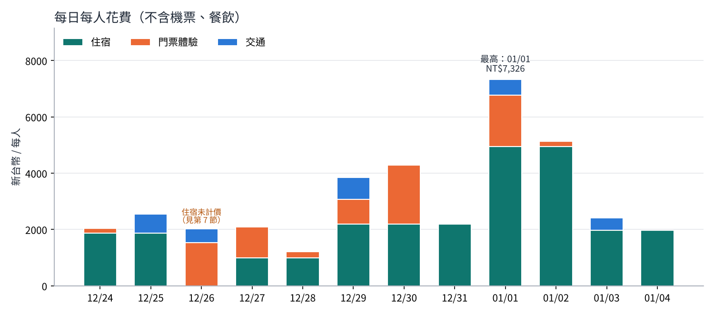
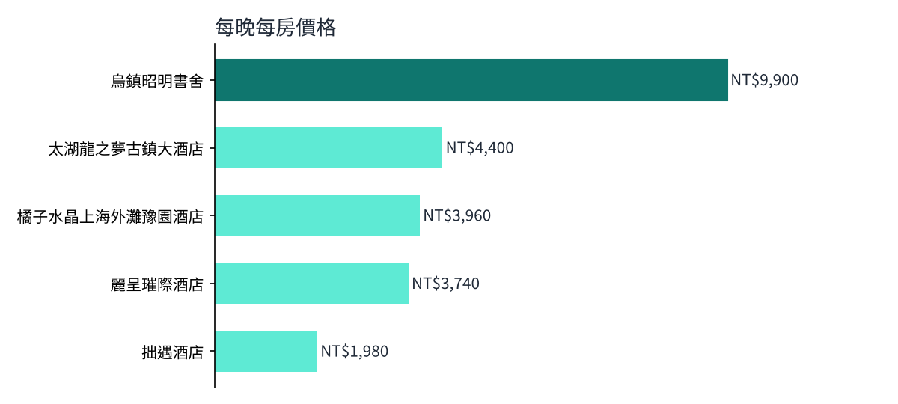

# 江南跨年 13 天旅遊花費分析

用 Python 把手排的 Excel 行程表整理成乾淨資料，分析一趟 13 天江南旅行**每人要花多少錢、錢花在哪裡**，並檢查行程表本身有沒有**資料不一致**。

> 這份資料就是我規劃「[江南跨年紀行](https://pingchen8833.github.io/shanghai-trip-13day/)」時用的行程表，分析結果直接拿來修正旅行預算。

## 主要發現

| 項目 | 結果 |
|---|---|
| 每人總花費 | 約 **NT$63,000**（2 人同行；匯率假設 1 人民幣 = 4.4 新台幣） |
| 最大支出 | **住宿 41%**、機票 32%，兩項合計超過七成 |
| 最貴的一天 | **01/01**（烏鎮景區內民宿＋古鎮門票），每人約 NT$7,300 |
| 資料問題 | 上海第一間飯店價錢只寫 **2 晚，實際要住 3 晚**，預算少算一晚 |





## 我做了什麼

1. **資料清理**：行程表的價錢寫法不一致（`台20000/1人`、`60/2人`、`兩晚1700/2人`、`480/1艘船`、`一份30`…），用正規表達式統一換算成「每人新台幣」
2. **避免重複計算**：「平均一晚」是由總價算出來的，只拿來檢查，不重複加總
3. **補足缺漏**：總表大多沒寫餐費，改從每天分頁的「人均 RMB 150–250」筆記抓出範圍，估算餐飲預算
4. **資料品質檢查**：比對每間飯店「實際住幾晚」和「價錢寫幾晚」，找出預算漏算
5. **視覺化**：類別占比、每日花費（住宿依晚數攤提到每一天）、住宿每晚價格比較

## 檔案

| 檔案 | 說明 |
|---|---|
| `trip_cost_analysis.ipynb` | 分析筆記本（每一步都有中文說明） |
| `data/上海.xlsx` | 原始行程表 |
| `outputs/` | 圖表 |

## 如何執行

```bash
pip install -r requirements.txt
jupyter notebook trip_cost_analysis.ipynb
```

匯率在筆記本開頭的 `RMB_TO_TWD` 設定，出發前請改成台灣銀行的最新匯率。

## 限制

- 餐飲依美食筆記的人均價格估算，未含每天的飲料與伴手禮
- 匯率為假設值；金額以 2 人同行計算
- 本專案在 AI 工具（Claude）協助下撰寫程式，分析問題的設定、資料來源與結果解讀由我負責

**技術**：Python、pandas、正規表達式、matplotlib、Jupyter
